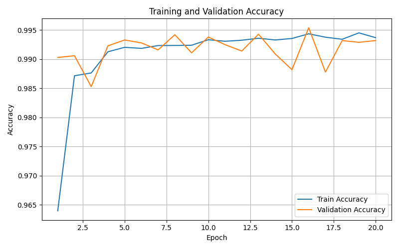
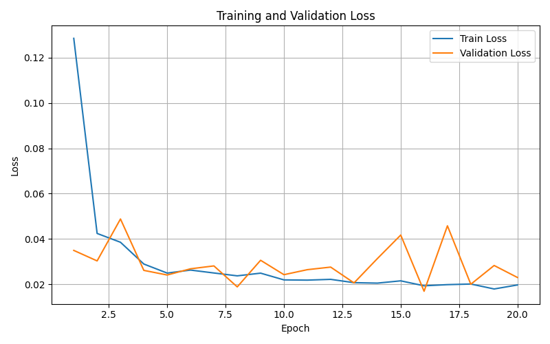
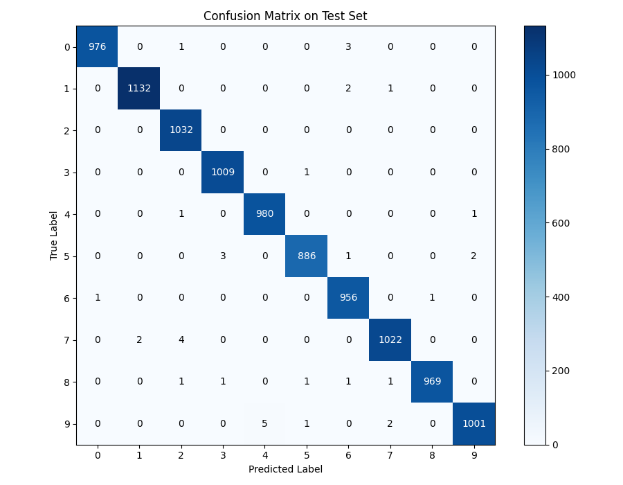
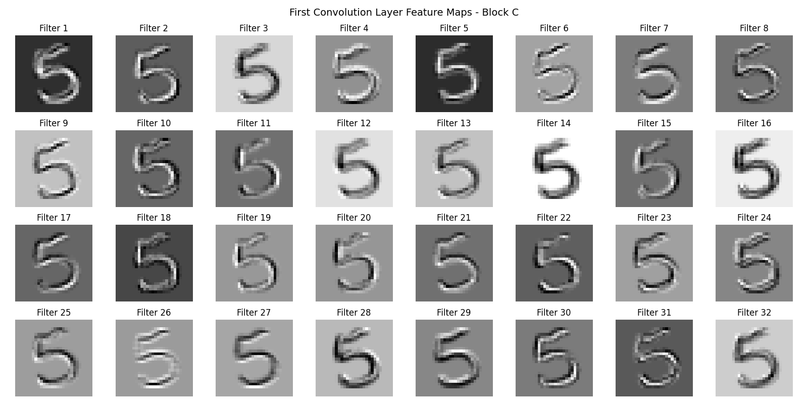
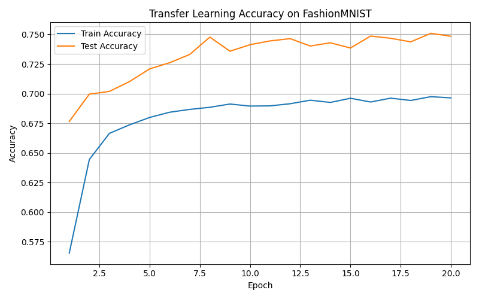
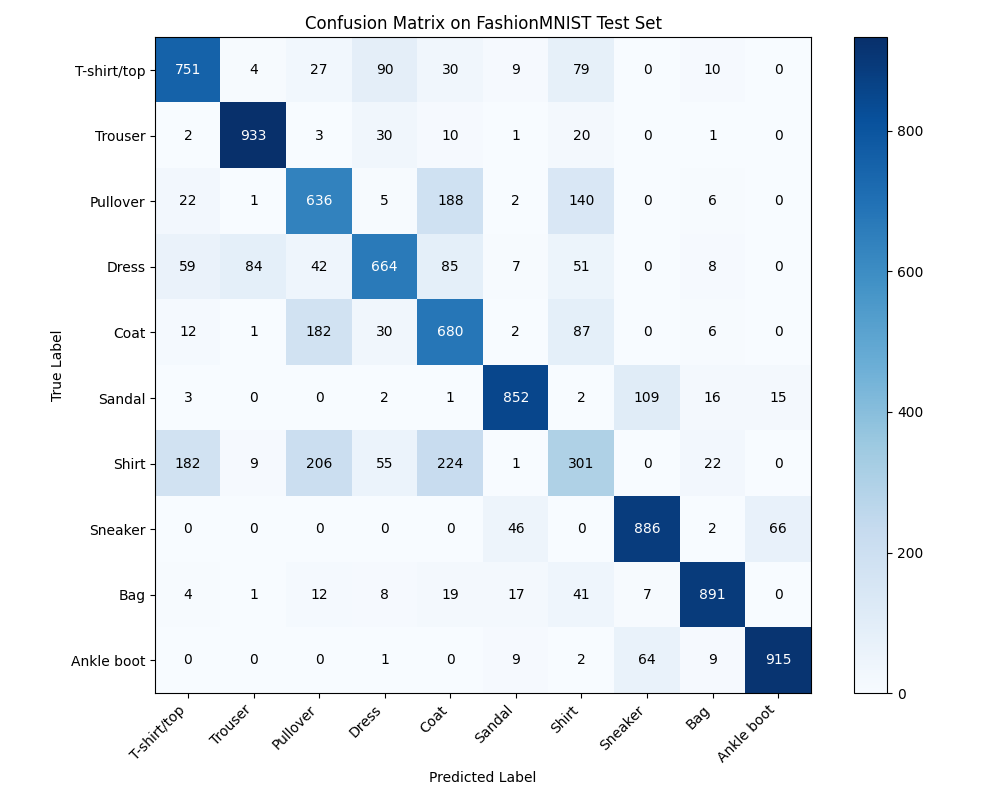

# CNN Architecture Exploration: Residual, Inception & ResNeXt Blocks

**An experimental PyTorch study of convolutional building blocks for handwritten-digit recognition, hybrid CNN architectures, and transfer learning to Fashion-MNIST.**

This project was developed for a deep learning course. It implements three interchangeable convolutional blocks, compares homogeneous and mixed-block networks on MNIST, visualizes learned features and training dynamics, and tests whether features learned from digit recognition transfer to clothing classification.

## Highlights

- **Three CNN building blocks:** ResNet-style residual (A), Inception-style multi-branch (B), and ResNeXt-style grouped-convolution residual (C).
- **Six evaluated architectures:** `AAA`, `BBB`, `CCC`, `CBC`, `CAC`, and `BCC` (the homogeneous models are selected using `--block A`, `B`, or `C`).
- **Best recorded MNIST test accuracy:** **99.63%** with the hybrid **CAC** model.
- **Frozen-feature transfer learning:** **75.09%** recorded Fashion-MNIST test accuracy when re-training a classification head on features from the C model.
- Saved training curves, confusion matrices, model checkpoints, and first-layer feature-map visualizations.

## Dataset

The supplied `data/dataset/mnist.pkl.gz` contains 28 × 28 grayscale digit images and labels for 10 classes, with the following splits:

| Split | Images |
| --- | ---: |
| Training | 50,000 |
| Validation | 10,000 |
| Test | 10,000 |

**Naming note:** Some classes and scripts use `PersianMNIST` in their names, but the bundled file is named `mnist.pkl.gz` and uses the conventional MNIST split structure. This README refers to it as *MNIST*; the archive alone does not establish a separate Persian-digits dataset provenance.

Training optionally uses small random affine perturbations (rotation up to 10°, translations up to 8%, and scale between 0.95 and 1.05). Validation and test images are not augmented.

## Model architecture

Each model receives a `1 × 28 × 28` image and predicts one of 10 classes. The common backbone is:

```text
Input (1 × 28 × 28)
  → Conv(1→32, 3×3) + BN + ReLU
  → Conv(32→64, 3×3) + BN + ReLU
  → MaxPool(2×2)
  → Block 1 (64→64)
  → Block 2 (64→128)
  → MaxPool(2×2)
  → Conv(128→256, 3×3) + BN + ReLU
  → MaxPool(2×2)
  → Block 3 (256→256)
  → Adaptive Average Pool (1×1)
  → Flatten → Dropout → Linear(256→10)
```

The three block positions can use the same design or a mixed sequence:

| Block | Inspiration | Implementation |
| --- | --- | --- |
| **A** | ResNet | Two 3×3 convolutions with a residual shortcut (1×1 projection when channel counts differ). |
| **B** | Inception | Four parallel paths: average pooling + 1×1 convolution, 1×1 convolution, 1×1 → 3×3, and 1×1 → 3×3 → 3×3; concatenate along channels. |
| **C** | ResNeXt | 1×1 reduction → 3×3 grouped convolution → 1×1 expansion, with a residual shortcut. |

For residual blocks, the output is

$$
y = F(x) + S(x),
$$

where $F$ is the convolutional path and $S$ is either an identity or projection shortcut (followed by ReLU in the implementation).

For the Inception-like block, the outputs of parallel branches are concatenated:

$$
y = [f_1(x), f_2(x), f_3(x), f_4(x)]_{\mathrm{channels}}.
$$

For grouped convolution in block C, channels are split into $g$ groups (default **8**), reducing connectivity within the spatial convolution. The bottleneck ratio defaults to **0.5**.

## Experimental results

The following numbers are copied from the **saved test-result logs** in `outputs/logs/`; they have not been recomputed for this README.

### MNIST classification

| Architecture | Special-block sequence | Test loss | Test accuracy |
| --- | :---: | ---: | ---: |
| Residual (A) | AAA | 0.0253 | 99.26% |
| Inception-like (B) | BBB | 0.0211 | 99.37% |
| ResNeXt-like (C) | CCC | 0.0215 | 99.38% |
| Mixed (CBC) | CBC | 0.0157 | 99.44% |
| **Mixed (CAC)** | **CAC** | **0.0113** | **99.63%** |
| Mixed (BCC) | BCC | 0.0235 | 99.27% |

**Observation:** The **CAC** configuration achieved the highest recorded test accuracy among these six runs, an improvement of **0.25 percentage points** over homogeneous C (`CCC`). These are individual logged experiments, not repeated-trial means; differences should not be interpreted as statistical significance without additional seeds.

> **Evaluation detail:** In `scripts/main.py`, the homogeneous A/B/C test results are computed from the model at the *last training epoch*, before the best-validation checkpoint is reloaded. In `scripts/mixed_blocks.py`, the mixed-model test results are computed *after* loading the best-validation checkpoint. Interpret the comparison with this difference in mind.

### Learning curves and error analysis

**Best-performing mixed architecture (CAC):**







Additional training curves and mixed-model confusion matrices are available in [`homework_code/outputs/plots/`](homework_code/outputs/plots/).

### Feature visualization

The project includes utilities to visualize feature maps produced by the first convolutional layer. An example for the C architecture is included below.



### Transfer learning: MNIST → Fashion-MNIST

For this experiment, a pretrained **C** network is loaded, its convolutional feature extractor is frozen, and the final linear classifier is replaced and trained on Fashion-MNIST (10 clothing categories).

| Transfer setup | Test loss | Test accuracy |
| --- | ---: | ---: |
| Frozen C feature extractor + newly trained classifier | 0.6906 | **75.09%** |





**Limitation:** The transfer-learning script evaluates on the Fashion-MNIST test set after every epoch and selects the best checkpoint using **test accuracy**. The 75.09% result is therefore test-set-selected and should not be treated as a completely unbiased held-out estimate. A separate validation set would be preferable for model selection.

## Getting started

### Requirements

- Python 3.10+ recommended
- PyTorch and torchvision (compatible versions)
- NumPy
- Matplotlib

Install the dependencies in a virtual environment:

```bash
python -m venv .venv
source .venv/bin/activate  # Windows: .venv\Scripts\activate
pip install torch torchvision numpy matplotlib
```

The code selects CUDA automatically when a compatible GPU is available; otherwise it runs on CPU. **Run the commands below from `homework_code/`.** The bundled MNIST data already resides at `data/dataset/mnist.pkl.gz`. Fashion-MNIST is downloaded automatically by torchvision when running the transfer script.

### Train a homogeneous CNN

```bash
cd homework_code
python scripts/main.py --block C --epochs 50 --batch-size 64 --lr 0.01 --optimizer sgd --use-augmentation
```

Replace `C` with `A` or `B` to select the other building blocks. The command defaults to SGD with momentum 0.9 and weight decay 0.0001; Adam is also supported via `--optimizer adam`. Note that `--use-augmentation` is opt-in.

### Train a hybrid CNN

```bash
python scripts/mixed_blocks.py --block-sequence CAC --epochs 50 --batch-size 64 --lr 0.001 --use-augmentation
```

`--block-sequence` accepts any three-character string composed of `A`, `B`, and `C` (for example, `CBC` or `BCC`). This script uses Adam.

### Run Fashion-MNIST transfer learning

First ensure that the pretrained C checkpoint exists at `models/saved_models/best_model_block_C.pth` (provided with the project or produced by training block C). Then run:

```bash
python scripts/transfer_fashion.py --pretrained-path models/saved_models/best_model_block_C.pth --epochs 20 --batch-size 64 --lr 0.01 --use-augmentation
```

The Fashion-MNIST classifier is trained with Adam while the pretrained feature extractor remains frozen.

## Project structure

```text
.
├── README.md
├── homework_code/
│   ├── config/config.yaml            # Data-related configuration values
│   ├── data/
│   │   ├── data_loader.py             # MNIST loading, splits, augmentation
│   │   └── dataset/mnist.pkl.gz       # Bundled digit dataset
│   ├── models/
│   │   ├── blocks.py                  # A, B, and C building blocks
│   │   ├── model.py                   # Homogeneous and mixed CNNs
│   │   └── saved_models/              # Saved PyTorch checkpoints
│   ├── scripts/
│   │   ├── main.py                    # Homogeneous-model experiments
│   │   ├── mixed_blocks.py            # Hybrid-model experiments
│   │   ├── transfer_fashion.py        # Frozen-feature transfer learning
│   │   ├── train.py                   # Training loop and checkpointing
│   │   └── evaluate.py                # Evaluation loop
│   ├── utils/                         # Metrics and visualizations
│   ├── outputs/
│   │   ├── logs/                      # Saved test results and epochs
│   │   └── plots/                     # Figures used in this README
│   └── notebooks/                     # Kaggle-related notebook
└── plots/                              # Additional copies of figures
```

Models and plots are written under `homework_code/`. The transfer-learning script saves its newly trained checkpoint to `homework_code/saved_models/`, whereas the original CNN checkpoints are under `homework_code/models/saved_models/`.

## Reproducibility and caveats

- `scripts/main.py` seeds Python, NumPy, and PyTorch with default seed `42`. The other experiment entry points do not implement the same explicit seed setup.
- Reported accuracies come from the supplied output files and may differ with software versions, randomness, training hyperparameters, and hardware.
- The supplied configuration YAML is not loaded by the entry-point scripts; use the command-line flags to control experiments.
- The architecture experiments use cross-entropy loss and save checkpoints based on validation accuracy.
- For rigorous comparisons, use the same checkpoint-selection protocol across architectures, repeat runs with multiple seeds, and keep test data out of model selection.

## Acknowledgment

Developed as a deep learning course project to investigate CNN architecture choices, feature representations, and transfer learning with PyTorch.
